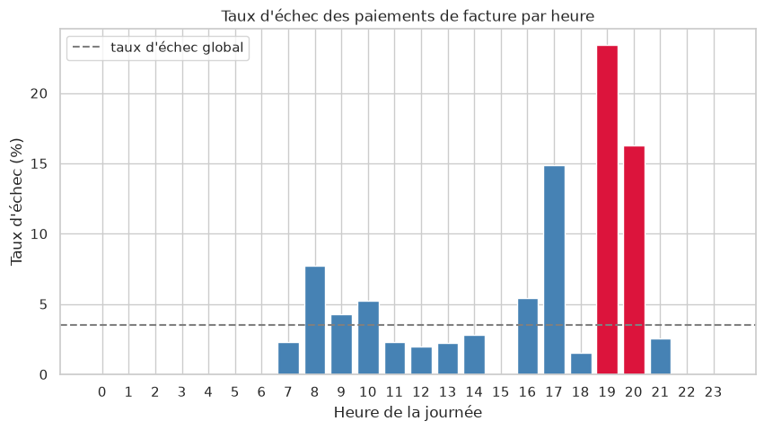
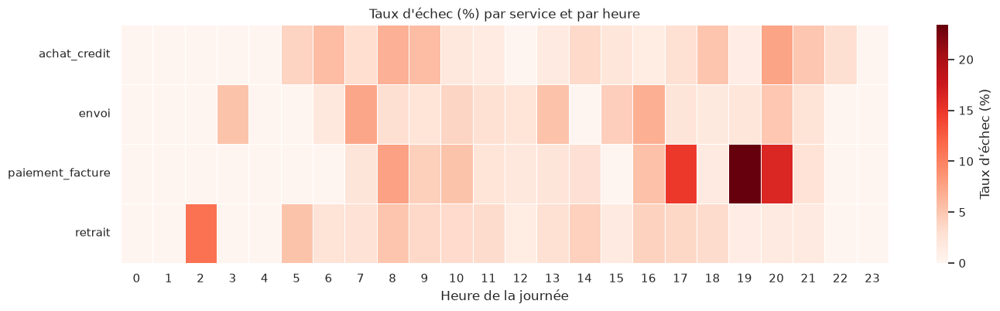
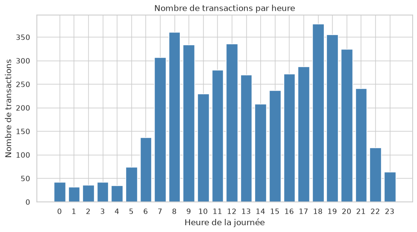
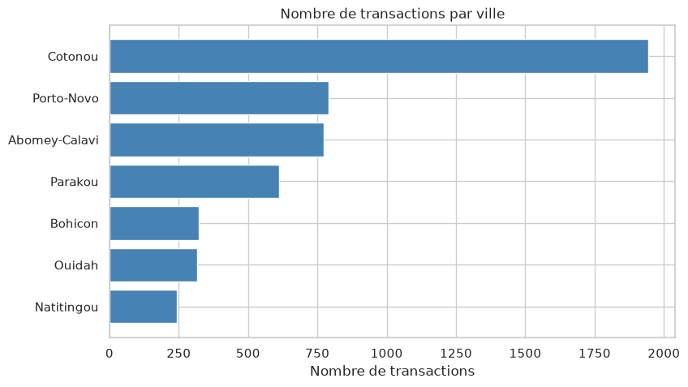
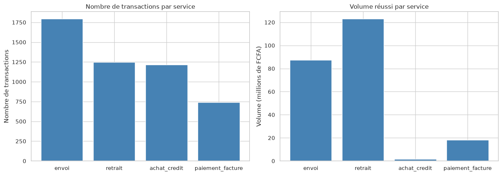
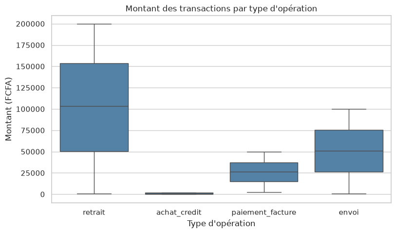

# Analyse de transactions mobile money

Projet personnel de **nettoyage et d'analyse de données** : à partir d'un fichier brut de
transactions mobile money (envois, retraits, paiements de facture, achats de crédit) dans 7 villes
du Bénin, je nettoie les données, je calcule des indicateurs et je cherche **quand et pourquoi les
transactions échouent**.

> ⚠️ Les données sont **fictives**, générées par `generate_data.py`, avec des défauts ajoutés
> volontairement. Les résultats ne décrivent pas un vrai opérateur : le but est de montrer la
> méthode.

## Résultat principal

Le taux d'échec global est faible (**3,5 %**), mais les **paiements de facture échouent 5 fois plus
souvent entre 19h et 21h** (20 % contre 3,7 % le reste de la journée), alors que les autres services
restent normaux à la même heure.





## Étapes

**1. Nettoyage** (5 100 lignes brutes → 5 000 transactions propres)

| Problème dans le fichier brut | Correction |
|---|---|
| 28 façons d'écrire 7 villes (`COTONOU`, `cotonou`, `" Cotonou "`) | espaces retirés, majuscules uniformisées |
| 786 dates au format `jj/mm/aaaa` au lieu de `aaaa-mm-jj` | format détecté puis converti |
| 59 montants négatifs | valeur absolue (erreur de signe) |
| 68 montants vides | médiane du même type d'opération |
| 100 doublons | supprimés |

**2. Analyse et visualisation** : heures de pic, jours de la semaine, services, villes, montants,
taux d'échec par service et par heure.

| | |
|---|---|
|  |  |
|  |  |

## Fichiers

| Fichier | Rôle |
|---|---|
| `generate_data.py` | génère le fichier brut `transactions.csv` |
| `transactions.csv` | données brutes (avec défauts) |
| `analyse.ipynb` | nettoyage, analyse et graphiques, avec les explications |
| `cleaned_transactions.csv` | données nettoyées |
| `graphiques/` | graphiques exportés |

## Lancer le projet

```bash
python3 -m venv venv
source venv/bin/activate
pip install -r requirements.txt
python3 generate_data.py
jupyter notebook analyse.ipynb
```

## Outils

Python, pandas, numpy, matplotlib, seaborn, Jupyter, Git / GitHub.
